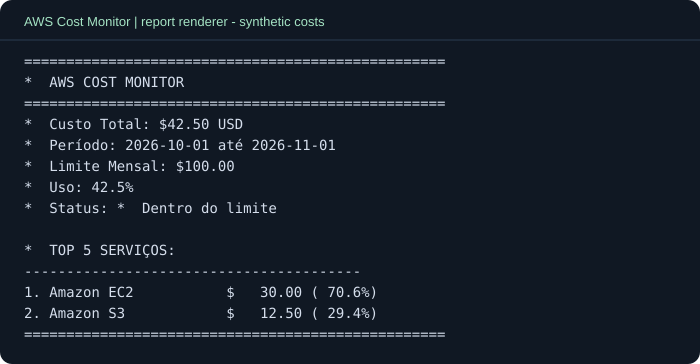

# AWS Cost Monitor

A Python CLI for inspecting AWS Cost Explorer spending, comparing periods, checking a configured monthly limit, and exporting reports.



The preview is generated by the project's report renderer using synthetic costs. No AWS account is queried to generate this image.

Terminal icons in the preview are normalized for portable rendering.

## Installation

Python 3.11 or newer is recommended.

```bash
git clone https://github.com/thomm-011/aws-cost-monitor.git
cd aws-cost-monitor
python3 -m venv .venv
source .venv/bin/activate
python -m pip install -r requirements.txt
python main.py --help
```

On Windows PowerShell, activate the environment with `.venv\Scripts\Activate.ps1`.

## Configuration and authentication

Use the standard Boto3 credential chain, for example `AWS_PROFILE` for a named profile configured outside this repository. The identity needs access to Cost Explorer, including `ce:GetCostAndUsage`, and Cost Explorer must be available for the account.

Edit `config/settings.json` from the repository root. A minimal configuration is:

```json
{
  "cost_limit_monthly": 100.0,
  "alert_threshold": 0.8,
  "currency": "USD",
  "email_alerts": false,
  "report_format": ["json", "csv"]
}
```

The `currency` setting labels console output; it does not perform currency conversion. The alert threshold is a fraction of the configured limit.

## Usage

```bash
# Console report plus JSON/CSV exports under reports/
python main.py --report

# Cost total for the previous seven days
python main.py --days 7

# Compare current month-to-date with the previous calendar month
python main.py --compare

# Print status against the configured limit
python main.py --check-alerts
```

Cost Explorer returns delayed billing data, not real-time spend. Requests may incur AWS API charges.

## Report behavior

- Monthly queries group costs by AWS service using `BlendedCost`.
- The processor handles grouped responses without a `Total` metric and includes negative cost adjustments.
- Monthly comparisons use Cost Explorer's [exclusive end-date convention](https://docs.aws.amazon.com/aws-cost-management/latest/APIReference/API_GetCostAndUsage.html).
- `--compare` compares a partial current month with the full previous month; it is not a normalized forecast.
- On the first day of a month, the empty month-to-date interval is represented as zero.

## Tests without AWS access

```bash
python -m unittest discover -s tests -v
```

Tests mock AWS client creation. They cover grouped responses, zero costs, empty periods, the previous month's end date, and CLI imports.

## Current limitations

The CLI prints alerts to the console. An SNS helper exists in `src/alert_manager.py`, but the CLI does not currently call it; setting `email_alerts` does not enable email delivery. Large, paginated Cost Explorer responses are not yet combined. Review billing data in the AWS console before making operational decisions.

## Code map

- `main.py`: CLI, console output, and JSON/CSV report generation.
- `src/cost_monitor.py`: Cost Explorer queries and data processing.
- `src/alert_manager.py`: standalone SNS helper.
- `config/settings.json`: local report/limit settings.

## Author

[Thomas Silva Cordeiro](https://thomm-011.github.io/) · [LinkedIn](https://www.linkedin.com/in/thomas-s-923082184/)
